<a href="https://kartikaysrivastava.in/">
  
</a>

  
  
  
  

  <a href="#selected-work">Selected work</a> ·
  <a href="#experience">Experience</a> ·
  <a href="#leadership-achievements">Achievements</a> ·
  <a href="#toolkit">Toolkit</a> ·
  <a href="#connect">Contact</a>

<strong>Backend systems · Data infrastructure · Applied AI</strong> 
I build reliable software from messy data, ambiguous requirements and real operational constraints.

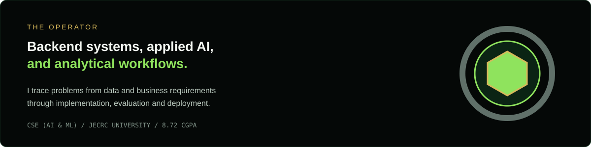

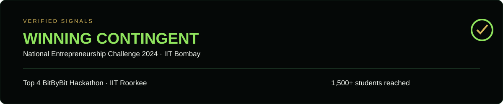

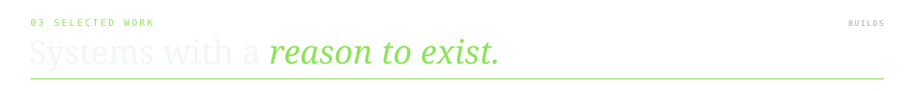

### Project index

| Project | What it demonstrates | Links |
|---|---|---|
| **GridForge AI** | Energy operations simulation, telemetry ingestion, constrained allocation and approval-driven dispatch | [Repository](https://github.com/KartikaySr/GridForge-AI) |
| **AetherQ** | PDF/DOCX ingestion, pgvector retrieval, source-linked RAG and Text-to-SQL | [Live demo](https://aether-q-rag-based-document-text-to.vercel.app/) · [Repository](https://github.com/KartikaySr/AetherQ--RAG-based-Document-Text---to---SQL-analyzer) |
| **Credit Card Fraud Detection** | Fraud-class evaluation across Random Forest, XGBoost, LightGBM and CatBoost | [Live demo](https://credit-card-fraud-detection-system-beta.vercel.app/) · [Repository](https://github.com/KartikaySr/Credit-Card-Fraud-Detection-System) |
| **Logi AI / A/B Testing** | Queue simulation, staffing comparisons, confidence intervals and two-proportion testing | [Call-centre simulation](https://github.com/KartikaySr/Call-Centre-Simulation-Logi-AI-V1) · [A/B suite](https://github.com/KartikaySr/Statistical-A-B-Testing-Suite) |

<a href="https://github.com/KartikaySr/GridForge-AI">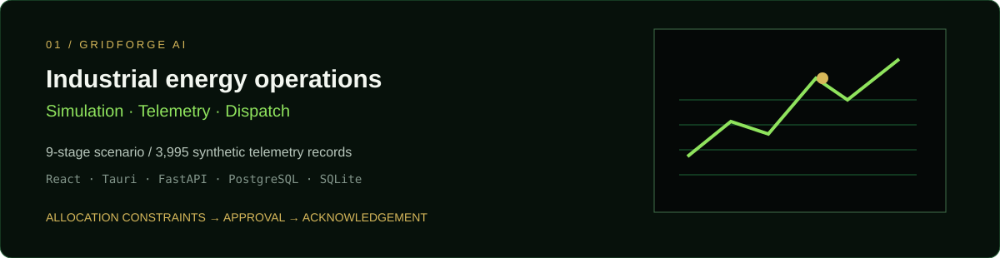</a>

  

<a href="https://github.com/KartikaySr/AetherQ--RAG-based-Document-Text---to---SQL-analyzer">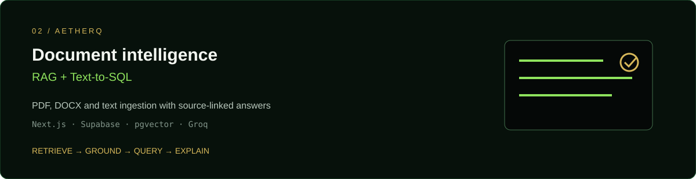</a>

  
  

<a href="https://github.com/KartikaySr/Credit-Card-Fraud-Detection-System">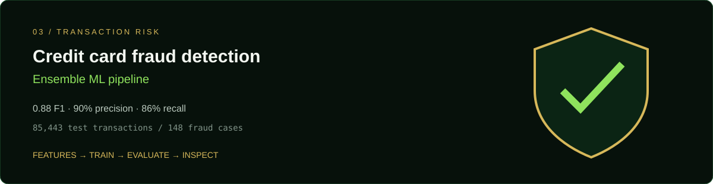</a>

  
  

<a href="https://github.com/KartikaySr/Call-Centre-Simulation-Logi-AI-V1">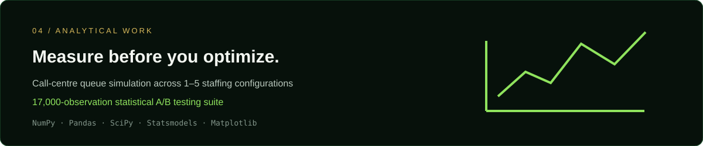</a>

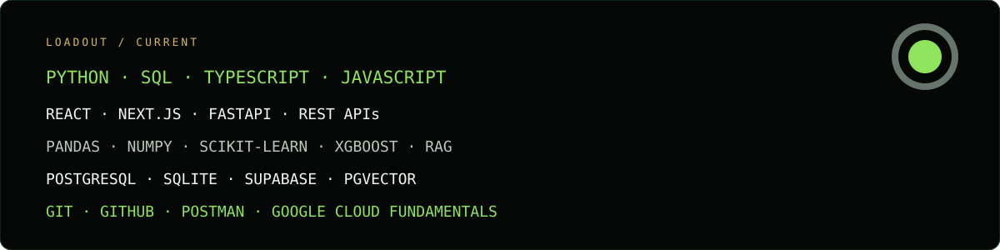

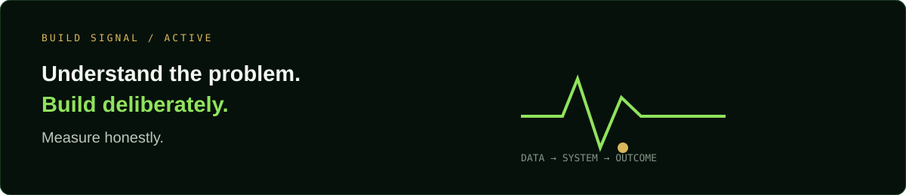

  

### Experience, in detail

**Software Engineer Intern · Grids Apps LLC**  
*Remote, Palestine · Jul 2026 – Present*

- Shipped production-grade full-stack features and RESTful APIs using React.js and Node.js.
- Built two full-stack products with an international distributed team, owning design, frontend/backend development, API integration, testing, debugging and release preparation.
- Deployed an Android application through Google Play Console and a web application to production.

**Data Analytics Intern · Samatrix Consulting Pvt. Ltd.**  
*Remote, India · Jun 2025 – Jul 2025*

- Automated operational reporting with Python backend pipelines processing **10,000+ call-centre records**.
- Used Python and Pandas for data preparation, validation, statistical analysis and preprocessing workflows.

**Commercial Apprentice · Fracht Kenya (Swiss MNC)**  
*Nairobi, Kenya · Jul 2025 – Aug 2025*

- Streamlined international freight workflows across operations, commercial and customs teams.
- Analyzed commercial opportunities across East African markets and reviewed logistics data-capture and reporting workflows.

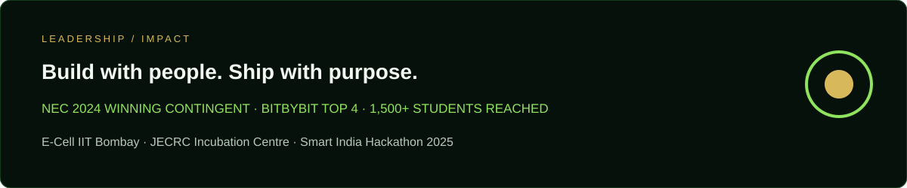

### Leadership &amp; achievements

- **National Winning Team** — National Entrepreneurship Challenge (NEC) 2024, IIT Bombay.
- **Top 4 Team** — BitByBit 48-Hour Hackathon, Cognizance 2025, IIT Roorkee.
- **Smart India Hackathon 2025** — developed an ML-powered career advisory platform.
- **Operations Lead** — JECRC Incubation Centre, Oct 2023–Nov 2024; coordinated entrepreneurship development and engaged **1,500+ students**.
- **Campus Executive (Strategic Operations)** — E-Cell, IIT Bombay, Jul–Dec 2024; represented JECRC University and contributed to the NEC 2024 winning contingent.
- **McKinsey.org Forward Program** — ongoing professional development.

### Certifications

DSA with Java (Apna College) · Cloud Computing Foundations (Google) · Natural Language Processing using spaCy (Udemy) · Neural Networks &amp; Deep Learning (Samatrix) · Data Analysis Using Python · Deep Learning with Python · Leadership &amp; Team Effectiveness

### GitHub activity

  
  

  
  
  

